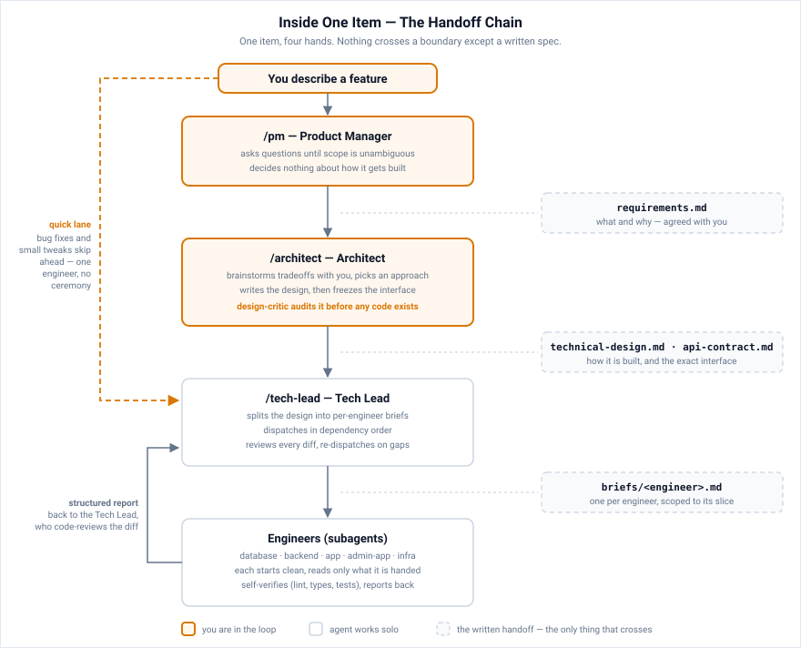
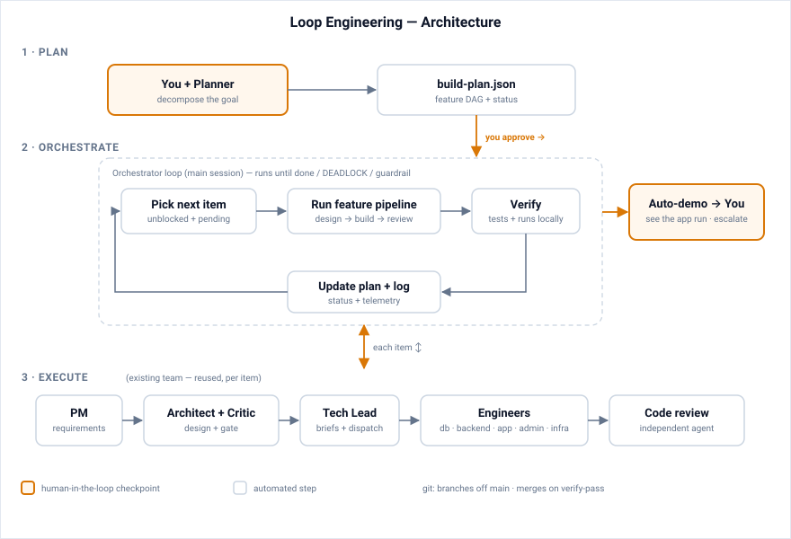

# Chain of Custody

**Make Claude Code work like a small software team: it plans your app, designs each feature, writes the code, reviews its own work, and shows you each piece running on your machine.**

You bring an idea, or a feature you want added to an existing project. Chain of Custody turns Claude into a team with a clear division of labor. A product manager asks what you actually need. An architect designs how to build it. A tech lead splits the design into tasks. Specialist engineers write the code. Separate reviewers check the design before any code is written and check the code before it's accepted.

There's nothing to install and nothing to configure. It's a folder of instructions (`.claude/`) that you copy into your project. Claude Code picks it up automatically, and adapters for Codex and Cursor are included.

## What it looks like

Building a new app from an idea takes two commands:

```text
you     /planner
        I want a simple app where my book club can suggest books and vote on next month's pick.

claude  Asks a handful of plain-language questions (Who can sign in? Can anyone add a book?).
        Recommends a tech stack and explains why in plain terms.
        Writes a build plan:
          1. A minimal app that runs, with one passing test
          2. Sign-in for club members
          3. Suggest a book
          4. Vote on suggestions
          5. Show this month's winner
        Waits for your approval.

you     Looks good.
        /orchestrate

claude  Builds the plan one item at a time: designs it, writes it, tests it, reviews it.
        At each checkpoint it starts the app on your machine and shows you the feature working.
        Waits for you to approve, reject with feedback, or stop.
```

Everything happens locally. Nothing is deployed and nothing is pushed to GitHub until you decide to do it.

For smaller jobs there are shortcuts: describe one feature and it runs the same team on just that feature, or type `/tech-lead` for a bug fix and it sends one engineer to fix it.

## Why not just ask Claude?

Asking Claude directly works well for small edits. On anything bigger, a single long chat tends to go wrong in predictable ways:

- **It forgets.** Decisions from early in the conversation get lost as the context fills up.
- **It skips the thinking.** It jumps to writing code before working out the design, and the gaps show up later as bugs.
- **It grades its own homework.** The same session that wrote the code reviews the code.
- **It leaves no record.** A month later, nobody can say why something was built the way it was.

Chain of Custody fixes this by making every step produce a written document and hand it to the next role:

| Step | Who | Writes |
|---|---|---|
| 1. What are we building? | Product Manager (`/pm`) | `requirements.md` |
| 2. How will we build it? | Architect (`/architect`) | `technical-design.md` and `api-contract.md` |
| 3. Is the design sound? | Design Critic | A list of problems to fix before coding starts |
| 4. Who builds which part? | Tech Lead (`/tech-lead`) | One brief per engineer |
| 5. Build it | Engineers (database, backend, app, admin app, infra) | Code, tests, and a report of what they did |
| 6. Is the code right? | Code review | Approval, or specific fixes to make |

Each role starts with a clean slate and reads only the document it was handed, so nothing depends on what an earlier conversation happened to remember. Those documents stay in your project as a paper trail of who decided what, and why. That's where the name comes from: like evidence in a court case, the work changes hands only with a signed record of each handoff.

## Who it's for

- **Solo developers and small teams** who use Claude Code and want it to behave like a disciplined engineering team rather than a freeform assistant.
- **People with an idea who aren't deeply technical.** You'll be asked product questions in plain language ("Can a regular user see other people's records, or only their own?"). Technical choices are recommended and explained for you. Start with the [plain-language guide](docs/getting-started.md), and keep the [glossary](GLOSSARY.md) handy.

It works on an empty folder or an existing codebase, in any language or framework.

## Quick start

**1. Copy the `.claude/` folder into your project.** This is the only required step.

```bash
git clone https://github.com/smaharj1/chain-of-custody.git /tmp/chain-of-custody
cd /path/to/your/project
cp -r /tmp/chain-of-custody/.claude .
```

> ⚠️ **Already have a `.claude/` folder in this project?** Copying will merge into it and can overwrite your `settings.json`, `CLAUDE.md`, and any agents or commands you've added. Back it up first (`cp -r .claude .claude.backup`) and merge by hand. The kit's `settings.json` adds two safety hooks (`guard-git.sh`, `guard-main-edit.sh`) and an empty permission allowlist, so fold those into your file rather than replacing it, and append the kit's `CLAUDE.md` to yours.

**2. Ignore the kit's log and lock files** by adding these lines to your project's `.gitignore`:

```gitignore
.claude/metrics.jsonl
.claude/loop.jsonl
.claude/orchestrate.lock
.claude/settings.local.json
.claude/launch.json
.claude/worktrees/
```

(`.claude/launch.json` is the desktop app's preview config. It holds per-machine ports and commands, so keep it out of git.)

Do commit `build-plan.json` and `BUILD_PLAN.md` when they appear. They're the build plan, and the loop needs them to pick up where it left off.

**3. Start Claude Code and pick the command that matches what you're doing.**

```bash
claude
```

| You want to... | Type | What happens |
|---|---|---|
| Build a new app, or a big batch of features | `/planner`, then `/orchestrate` | The Planner interviews you and writes a build plan. The Orchestrator builds it item by item and shows you each piece running. |
| Add one feature to an existing project | Just describe it (or `/pm`) | The PM asks questions, then hands off to `/architect` and `/tech-lead` for that one feature. |
| Fix a bug or make a small change | `/tech-lead` | Sends one engineer straight to the fix. It'll tell you if the job is bigger than it looks. |
| Think through a technical design | `/architect` | Works through the tradeoffs with you and writes the design. |

That's it. There are no templates to fill in and no setup questionnaire. The agents work out what they need to know about your project on their own (see [How the agents learn your project](#how-the-agents-learn-your-project)).

**Optional:** copy the human-readable guides too, so they sit next to your code. (`choosing-your-stack.md` now lives inside `.claude/context/`, so it comes along with the folder you already copied; `/planner` reads it from there.)

```bash
mkdir -p docs
cp /tmp/chain-of-custody/docs/{getting-started,faq}.md docs/
```

Links in those guides to `GLOSSARY.md`, this README, and `examples/` point back at the kit, so keep your clone around or bookmark the repo.

## What still needs you

The loop runs on its own between checkpoints, but some things can't be automated:

| Moment | Why |
|---|---|
| **Approving the plan** | Nothing gets built until you've said yes to the plan. |
| **Checkpoints** | By default the loop stops after each milestone, starts your app, and shows you the working feature. You approve it, reject it with feedback (it undoes the item and tries again), or stop. Set `autonomy: per-feature` in `.claude/loop.config.md` to see every item. |
| **Product questions** | "Can a regular user see other people's records?" The answer isn't in any codebase. |
| **Secrets** | When an item needs an API key (payments, email), the loop stops and asks. No agent can invent a credential. |
| **Security blocks** | If the security reviewer finds a Critical or High issue, the item won't be marked done until you fix it or record a waiver with a reason. |
| **The very first item** | On a new project, item one is the skeleton every later item copies. If something looks off, say so then rather than ten items later. |
| **Publishing** | Finished work stays on your machine. The kit's safety hook blocks `git push` for every agent, so Claude can't publish for you: when you're happy, Claude prints the exact `git push` (and PR) commands and you run them yourself. |

## How it works

### The handoff chain

<p align="center">
  
</p>

Every arrow in the diagram is a file. This is the chain you drive by hand with `/pm`, `/architect`, and `/tech-lead`, one feature at a time.

<details>
<summary>Text version of the diagram</summary>

```
You describe a feature
  |
  v
/pm  -->  Asks you questions
  |       Writes docs/features/<slug>/requirements.md
  v
/architect  -->  Talks through tradeoffs with you
  |              Writes technical-design.md + api-contract.md
  |              Runs design-critic (catches problems before code)
  v
/tech-lead  -->  Writes one brief per engineer
  |              Dispatches engineers in dependency order
  |              Reviews each engineer's code
  |              Handles escalations and re-dispatch
  v
Engineers (subagents)  -->  Read their project notes + brief + design + contract
                            Write code that matches the project's existing patterns
                            Run lint and tests on their own work
                            Report back what they did and what they learned
```

</details>

### The build loop

<p align="center">
  
</p>

`/planner` and `/orchestrate` wrap that same team in a loop so it can build a whole idea instead of one feature.

- **`/planner`** interviews you, makes the big technical decisions with you, and writes `build-plan.json`: a checklist ordered so that nothing is built before the things it depends on. It also writes down how to run and test your app. It never builds anything itself, and finishes by telling you to run `/orchestrate`.
- **`/orchestrate`** takes the next ready item, runs it through the team (design, build, review, security check where relevant), verifies that the tests really ran and passed, merges it into your local `main`, and moves on. At checkpoints it starts the app and shows you the result.

Inside the loop the team runs without you in the chair, so three things change. The PM and Architect work out requirements from the plan item instead of interviewing you. Requirements are passed along directly instead of being written to `requirements.md`. And code review goes to a separate `code-reviewer` agent, because the Orchestrator wrote the design and the briefs and shouldn't also be the one approving the result.

How often the loop stops for you, how much work it may do per run, and the commands it uses to test your app all live in [`.claude/loop.config.md`](.claude/loop.config.md).

### The team

| Agent | Writes code? | Job |
|---|---|---|
| **Database Engineer** | Yes | Schema changes and migrations |
| **Backend Engineer** | Yes | API endpoints, services, business logic |
| **App Engineer** | Yes | The main frontend app |
| **Admin App Engineer** | Yes | An admin dashboard |
| **Infra Engineer** | Yes | Infrastructure-as-code |
| **Design Critic** | No | Reviews the design before any code is written |
| **Code Reviewer** | No | Independent review of every change, in a clean context, in the interactive lanes and inside `/orchestrate` alike |
| **Security Reviewer** | No | Security audit. Runs automatically in the loop on items touching sign-in, payments, file uploads, or user input; run it yourself before a deploy or PR otherwise |

The reviewers only read. They report problems and never edit code themselves.

### How the agents learn your project

To write code that fits your project, the engineers need to know its stack, its structure, its conventions, and which existing file is the best example to copy. That knowledge lives in short notes called **primers** (`.claude/context/*.md`), and **the agents write them, not you.**

Each primer ships as an empty template. The first role that needs one fills it in from evidence: the code itself on an existing project, or the decisions the Planner made with you on a new one. You're never asked what an ORM is or which router you use. You're only asked product questions that can't be read from code. The full rules are in [`primer-protocol.md`](.claude/context/primer-protocol.md).

| Primer | Written by | When |
|---|---|---|
| `.claude/CLAUDE.md` | Planner, then the first build item | Tech stack and repo layout, written at plan time and updated once the skeleton exists |
| `.claude/context/architect.md` | Architect | Before its first design |
| `.claude/context/backend.md`, `database.md`, `shared-frontend.md`, `app.md`, `admin-app.md`, `infra.md` | Tech Lead or Architect | Before the first engineer in that area starts |
| `.claude/context/local-dev.md` | Planner | At plan time. The run, test, and reset commands are proven by running them, not guessed |
| `.claude/loop.config.md` | Planner | At plan time |
| `.claude/context/engineer-protocol.md`, `primer-protocol.md` | Nobody | Shared kit rules. Leave these alone |

**Primers stay current on their own.** The engineer writing the code is the first to notice when a primer is out of date, so every engineer report includes a `## Primer Delta` section listing new patterns, dead references, or conventions the code has moved past. Engineers report but don't edit. The role holding the whole picture (the Tech Lead at wrap-up, the Orchestrator after each item) applies the change. If a primer and correct code disagree, the code wins and the primer gets fixed.

**When something can't be known yet**, such as an example file on a brand-new project, the section is marked `TODO(primer)` and `/orchestrate` keeps a checkpoint at every item until it's resolved. Missing run or test commands are a hard stop instead, because the loop can't verify anything without them.

They're plain markdown, and reading what the agents wrote about your project is a good use of ten minutes. Correct anything you know is wrong. To see how much detail a filled-in primer should have, look at [`examples/`](examples/README.md): every primer written out for a made-up app called TaskFlow, plus one feature's full set of handoff documents. It's a writing reference, not a demo. There's no code behind it.

### Starting from scratch

On an empty folder, start with `/planner`, not `/pm`. Engineers normally copy patterns from existing code, and an empty folder has none, so:

1. **The Planner always makes item one a runnable skeleton:** a minimal app, a test setup, and one passing test. You never scaffold the project by hand.
2. **That skeleton sets the patterns** (folder layout, error handling, naming) that every later item copies. Give it more attention than the rest.
3. **Once it ships,** the Orchestrator points the primers at its files as the examples to follow, and the normal workflow takes over.

`/orchestrate` runs `git init` for you if the folder isn't a repository yet.

## Prerequisites

**Required**

- [Claude Code](https://docs.anthropic.com/en/docs/claude-code), installed and signed in. Any recent version works (the kit uses agent definitions in `.claude/agents/`, PreToolUse hooks, and the Skill tool).
- `git`. The loop builds each item on a branch and merges it locally.
- `python3` on your PATH. The two safety hooks use it, and without it they quietly switch themselves off, which removes the git guardrails.
- **Permissions set up before long loop runs.** Claude Code asks before running any command it hasn't been allowed to run, regardless of the loop's autonomy setting, so an unattended run will stall at the first new command. The kit ships an empty allowlist on purpose, and the agents never edit your settings files (that would let them widen their own permissions). Before a long run, the Planner prints a proposed snippet of your project's run, test, and build commands; you paste it into `.claude/settings.local.json`. See [`platform-notes.md`](.claude/context/platform-notes.md). For interactive work the prompts are normal.

**Recommended**

- **A documentation MCP** (optional) for up-to-date library docs. The agents don't require any particular one: without it they fall back to fetching the library's own docs. To give an agent a docs tool, add the tool's name to that agent's `tools:` line and remove `mcp__*` from its `disallowedTools:` (both edits; the deny wins). Details in [`platform-notes.md`](.claude/context/platform-notes.md).

**Optional**

- A browser-preview MCP so checkpoints can include screenshots (the bundled `/run` skill is the next fallback), and a push-notification tool for checkpoint alerts. Without them the loop describes the demo in text and flags checkpoints in the transcript.

## Using Codex or Cursor

The `.claude/` folder is the single source of truth. Thin adapters point other coding agents at it, so the workflow is the same everywhere:

- **Codex:** `AGENTS.md` for repository instructions, or `skills/chain-of-custody/SKILL.md` as a reusable skill.
- **Cursor:** `.cursor/rules/chain-of-custody.mdc`, an always-on project rule.

Copy the adapter your tool loads along with `.claude/`.

## Customizing

**Change the team to match your project.** The Tech Lead only dispatches engineers that exist, so adding or removing an agent file is all it takes.

- **No admin app or no infrastructure?** Delete `agents/admin-app-engineer.md` and `context/admin-app.md`, or `agents/infra-engineer.md` and `context/infra.md`.
- **More than one frontend** (a mobile app, say)? Duplicate `agents/app-engineer.md` as `mobile-app-engineer.md`, update its `name:` field, and copy `context/app.md` to `context/mobile-app.md`. Leave the copy as a template and the agents will fill it in. Note that checkpoints can't screenshot a phone simulator, so mobile demos fall back to API and test checks.
- **No frontend at all** (an API or CLI tool)? Delete the app agents and `context/shared-frontend.md`. The API contract template becomes your interface contract. See the [FAQ](docs/faq.md).
- **Rename an agent?** Rename the file and update `name:` in its frontmatter.
- **A different language?** Nothing to change. The agents work out your stack from the code.
- **Want another specialist,** like a UI designer? Add `agents/ui-designer.md` following the pattern of the existing agents.

**Which files are yours and which are the kit's:**

- **Yours, written by the agents:** `.claude/CLAUDE.md`, `.claude/context/*.md` (except the kit-logic files listed in the tree below), `.claude/loop.config.md`, `.claude/settings.json`. Review and correct them freely. Never overwrite them when updating the kit.
- **The kit's, safe to replace on update:** `.claude/agents/`, `.claude/commands/`, the kit-logic files in `.claude/context/` (the protocols, rules and `choosing-your-stack.md`), `.claude/hooks/`, `.claude/spec/`, `.claude/templates/`, `.claude/KIT_VERSION`. You can edit the templates, but an update will overwrite your changes, so keep a note of them.

## Updating the kit

Your copy records its version in `.claude/KIT_VERSION`, and every change is listed in [CHANGELOG.md](CHANGELOG.md).

1. Check your `.claude/KIT_VERSION` and read the CHANGELOG entries since that version.
2. Re-copy the kit's files listed above from the new release (skip `agents/` if you've added or renamed agents, and merge by hand instead).
3. Never overwrite your own files listed above. If a CHANGELOG entry touches one of them, such as a new settings hook, merge that change by hand.

## Reference

<details>
<summary>File structure</summary>

```
.claude/
  CLAUDE.md                          # Project description + conventions (agent-written)
  KIT_VERSION                        # Which kit release this copy came from
  settings.json                      # Claude Code settings (permissions + the two safety hooks)
  loop.config.md                     # Loop settings: autonomy, budgets, verify commands, db, git
  agents/                            # Subagent definitions
    backend-engineer.md              #   Backend API engineer
    database-engineer.md             #   Database/migration engineer
    app-engineer.md                  #   Main frontend app engineer
    admin-app-engineer.md            #   Admin dashboard engineer
    infra-engineer.md                #   Infrastructure engineer
    security-reviewer.md             #   Security auditor (read-only)
    design-critic.md                 #   Design reviewer, before code (read-only)
    code-reviewer.md                 #   Independent code reviewer in the loop (read-only)
  commands/                          # Slash commands
    pm.md                            #   /pm: requirements
    architect.md                     #   /architect: technical design
    tech-lead.md                     #   /tech-lead: briefs, dispatch, review
    planner.md                       #   /planner: whole-idea build plan
    orchestrate.md                   #   /orchestrate: run the plan item by item
  context/                           # Primers: project knowledge (agent-written)
    engineer-protocol.md             #   Shared rules for all engineers (kit logic)
    primer-protocol.md               #   How agents write and maintain primers (kit logic)
    probe-protocol.md                #   How to prove an unknown repo's commands safely (kit logic)
    migrations.md                    #   Expand, backfill, contract; down-migration data-loss classes (kit logic)
    local-dev-rules.md               #   Dialect parity, process groups, ports (kit logic)
    model-profiles.md                #   quality / balanced / economy model routing (kit logic)
    platform-notes.md                #   Permissions snippet, capabilities, docs tools, hooks (kit logic)
    choosing-your-stack.md           #   Stack recommendations by project type (kit logic)
    architect.md                     #   System architecture
    backend.md                       #   Backend patterns
    database.md                      #   Schema + migrations
    shared-frontend.md               #   Conventions shared by frontend apps
    app.md                           #   Main app
    admin-app.md                     #   Admin app
    infra.md                         #   Infrastructure
    local-dev.md                     #   How to run, test, and reset the app locally
  hooks/
    guard-git.sh                     #   Blocks push, rebase, and other shared-history git commands
    guard-main-edit.sh               #   Blocks app-code edits directly on main
  spec/
    loop-engineering.md              #   The authoritative loop spec /orchestrate follows
  templates/                         # Document templates the roles fill in
    requirements.md
    technical-design.md
    api-contract.md
    brief.md
    build-plan.md
    domain-glossary.md               #   Copy to docs/domain-glossary.md in your project: what your domain words mean
  metrics.jsonl                      # Interactive telemetry (auto-created, gitignored)
  loop.jsonl                         # Loop telemetry (auto-created, gitignored)
  orchestrate.lock                   # Run lock (auto-created, gitignored)
build-plan.json                      # The build plan (commit this)
BUILD_PLAN.md                        # Readable view of the plan (commit this)
docs/
  getting-started.md                 # Plain-language guide
  faq.md                             # Testing, CI, deploying, teams, non-web projects
  features/<feature-slug>/           # Created per feature; scratch space, not long-term
    requirements.md
    technical-design.md
    api-contract.md
    briefs/<engineer>.md
    reports/<engineer>.md
examples/                            # Filled-in documents for a fictional app (TaskFlow).
                                     #   A writing reference. No code, not a runnable demo.
```

`docs/assets/` (diagrams) and `docs/design/` (the kit's own review history) exist only in this repo. Don't copy them.

</details>

<details>
<summary>Feedback signals the team produces</summary>

- **Brief gaps.** When an engineer can't find something it needs, it reports a "brief gap" instead of guessing. These tell the Tech Lead what to include in future briefs.
- **Primer deltas.** Described [above](#how-the-agents-learn-your-project): engineers report where the project notes are out of date, and the lead role fixes them.
- **Telemetry.** After every feature or task, the Tech Lead appends a line to `.claude/metrics.jsonl` with timing, retry counts, and brief gaps. The loop logs to `.claude/loop.jsonl`, including which primers were updated per item, so a long run of "nothing to update" stands out as possible drift.

</details>

## Project status

V1. The build loop runs items **one at a time**. Running items in parallel and a dedicated mode for scaffolding new projects are planned but not built yet. The full design, and the review rounds behind it, are in [`.claude/spec/loop-engineering.md`](.claude/spec/loop-engineering.md).

## More documentation

- [Getting started](docs/getting-started.md): a plain-language walkthrough, no coding experience assumed
- [Glossary](GLOSSARY.md): every term used here, explained
- [FAQ](docs/faq.md): testing, CI, deploying, teams, monorepos, non-web projects
- [Choosing your stack](.claude/context/choosing-your-stack.md): what technology to use if you don't know
- [Examples](examples/README.md): filled-in documents for a fictional project, to calibrate against

## License

MIT. See [LICENSE](LICENSE).
