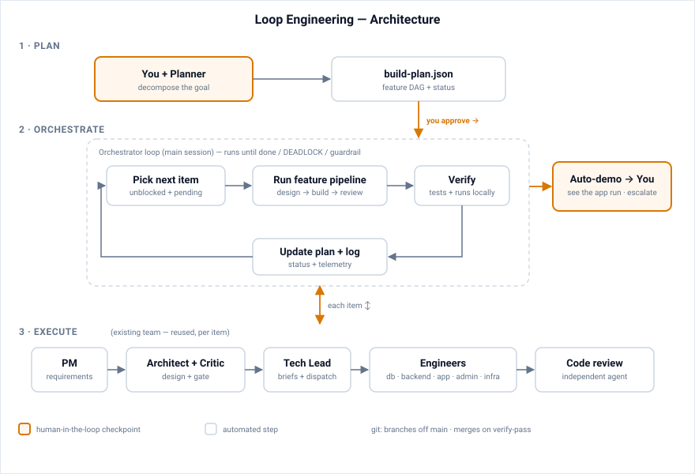

# Chain of Custody

**Make Claude Code work like a small software team: it plans your app, designs each feature, writes the code, reviews its own work, and shows you each piece running on your machine.**

You bring an idea, or a feature you want added to an existing project. Chain of Custody turns Claude into a team with a clear division of labor. A product manager asks what you actually need. An architect designs how to build it. A tech lead splits the design into tasks. Specialist engineers write the code. Separate reviewers check the design before any code is written and check the code before it's accepted.

There is no service to run and no account to create. The kit is a Claude Code plugin: instructions, agents, guard hooks and small standard-library Python scripts. You install it once, run `/chain-of-custody:init` in a project, and Claude Code picks it up from then on. Codex and Cursor get a guidance-only copy ([`adapters/SETUP.md`](adapters/SETUP.md)).

## What it looks like

Building a new app from an idea takes two commands:

```text
you     /planner
        I want a simple app where my book club can suggest books and vote on next month's pick.

claude  Asks a handful of plain-language questions (Who can sign in? Can anyone add a book?).
        Recommends a tech stack and explains why in plain terms.
        Writes a build plan:
          1. A minimal app that runs, with one passing test
          2. Sign-in for club members
          3. Suggest a book
          4. Vote on suggestions
          5. Show this month's winner
        Waits for your approval.

you     Looks good.
        /orchestrate

claude  Builds the plan one item at a time: designs it, writes it, tests it, reviews it.
        At each checkpoint it starts the app on your machine and shows you the feature working.
        Waits for you to approve, reject with feedback, or stop.
```

Everything happens on your machine. Nothing is deployed. The Tech Lead and the Orchestrator may push a feature branch so you can open a pull request, but never `main` or another protected branch, and merging is always yours.

For smaller jobs there are shortcuts: describe one feature and it runs the same team on just that feature, or type `/tech-lead` for a bug fix and it sends one engineer to fix it.

## Why not just ask Claude?

Asking Claude directly works well for small edits. On anything bigger, a single long chat tends to go wrong in predictable ways:

- **It forgets.** Decisions from early in the conversation get lost as the context fills up.
- **It skips the thinking.** It jumps to writing code before working out the design, and the gaps show up later as bugs.
- **It grades its own homework.** The same session that wrote the code reviews the code.
- **It leaves no record.** A month later, nobody can say why something was built the way it was.

Chain of Custody fixes this by making every step produce a written document and hand it to the next role:

| Step | Who | Writes |
|---|---|---|
| 1. What are we building? | Product Manager (`/pm`) | `requirements.md` |
| 2. How will we build it? | Architect (`/architect`) | `technical-design.md` and `api-contract.md` |
| 3. Is the design sound? | Design Critic | A list of problems to fix before coding starts |
| 4. Who builds which part? | Tech Lead (`/tech-lead`) | One brief per engineer |
| 5. Build it | Engineers (database, backend, app, admin app, infra) | Code, tests, and a report of what they did |
| 6. Is the code right? | Code review | Approval, or specific fixes to make |

Each role starts with a clean slate and reads only the document it was handed, so nothing depends on what an earlier conversation happened to remember. Those documents stay in your project as a paper trail of who decided what, and why. That's where the name comes from: like evidence in a court case, the work changes hands only with a signed record of each handoff.

## Who it's for

- **Solo developers and small teams** who use Claude Code and want it to behave like a disciplined engineering team rather than a freeform assistant.
- **People with an idea who aren't deeply technical.** You'll be asked product questions in plain language ("Can a regular user see other people's records, or only their own?"). Technical choices are recommended and explained for you. Start with the [plain-language guide](docs/getting-started.md), and keep the [glossary](GLOSSARY.md) handy.

It works on an empty folder or an existing codebase, in any language or framework.

## Quick start

**1. Install the plugin**, from inside Claude Code in your project (Claude Code 2.1.302 or newer):

```text
/plugin marketplace add smaharj1/chain-of-custody
/plugin install chain-of-custody@chain-of-custody
```

When it asks where to install, choose the project scope. Or from a shell: `claude plugin marketplace add smaharj1/chain-of-custody`, then `claude plugin install chain-of-custody@chain-of-custody --scope project`. Use the project scope: it guards only this project and shares the plugin with everyone who opens it. A `--scope user` install guards every repository on the machine, including ones never set up for the kit. `smaharj1/chain-of-custody#v2.0.0` pins a release.

**2. Set up the project.** Open Claude Code in your project and run:

```text
/chain-of-custody:init
```

Use the full name: the short `/init` is Claude Code's own command. `/chain-of-custody:init` plans the project's own files in `.claude/`: `CLAUDE.md`, `loop.config.md`, empty primers in `.claude/context/`, and a `settings.json` with permissions and the sandbox. The guard hooks come from the plugin, so `settings.json` has none. It merges with files you already have and adds the kit's runtime files to `.gitignore`:

```gitignore
.claude/loop.jsonl
.claude/metrics.jsonl
.claude/orchestrate.lock
.claude/settings.local.json
.claude/launch.json
.claude/pr/
.claude/bootstrap/
.claude/.migrate/
.claude/worktrees/
.claude/settings.json.pre-init
.claude/settings.local.json.pre-migrate
```

plus a secrets block (`.env*`, `*.pem`, `*.key`, infrastructure state and more; see the dry run). Check it against files you track.

It changes nothing itself: it shows the diff and prints one command. Run it in a plain terminal (not inside Claude Code), then come back and say it ran. Review `git status` and `git diff`, and commit the new files yourself.

Do commit `build-plan.json` and `BUILD_PLAN.md` when they appear. They're the build plan, and the loop needs them to pick up where it left off.

The docs write the plugin's folder as `$KIT` in commands you run yourself. `/chain-of-custody:init` prints it as `kit: <path>`; run `export KIT=<that path>` in your shell. The path includes the plugin's version, so export it again after a plugin update. Commands the kit prints for you already have the full path.

**3. Run `/chain-of-custody:bootstrap` once, then pick the command that matches what you're doing.**

`/bootstrap` is an interview for a person at the keyboard. It detects your stack and tooling, writes the stack into `.claude/CLAUDE.md`, proposes the `loop.config.md` values, and generates a setup script (`.claude/bootstrap/setup.sh`) that **you** read and run. It changes files in your project only; the kit sets up nothing on GitHub. See [`docs/bootstrap.md`](docs/bootstrap.md).

The modes are namespaced by Claude Code: `/chain-of-custody:planner`, `/chain-of-custody:pm` and so on. This README writes them short (`/planner`).

| You want to... | Type | What happens |
|---|---|---|
| Build a new app, or a big batch of features | `/planner`, then `/orchestrate` | The Planner interviews you and writes a build plan. The Orchestrator builds it item by item and shows you each piece running. |
| Add one feature to an existing project | Just describe it (or `/pm`) | The PM asks questions, then hands off to `/architect` and `/tech-lead` for that one feature. |
| Fix a bug or make a small change | `/tech-lead` | Sends one engineer straight to the fix. It'll tell you if the job is bigger than it looks. |
| Think through a technical design | `/architect` | Works through the tradeoffs with you and writes the design. |

There are no templates to fill in by hand. The agents work out what they need to know about your project on their own (see [How the agents learn your project](#how-the-agents-learn-your-project)).

Four more modes are for a person at the keyboard and are never started by the loop: `/bootstrap` (above), `/chain-of-custody:init` (above), `/retro` (a retrospective over a milestone's run data) and `/migrate` (moves a project off an old copy install onto the plugin).

## What still needs you

The loop runs on its own between checkpoints, but some things can't be automated:

| Moment | Why |
|---|---|
| **Approving the plan** | Nothing gets built until you've said yes to the plan. |
| **Checkpoints** | By default the loop stops after each milestone, starts your app, and shows you the working feature. You approve it, reject it with feedback (it undoes the item and tries again), or stop. Set `autonomy: per-feature` in `.claude/loop.config.md` to see every item. |
| **Product questions** | "Can a regular user see other people's records?" The answer isn't in any codebase. |
| **Secrets** | When an item needs an API key (payments, email), the loop stops and asks. No agent can invent a credential. |
| **Security blocks** | If the security reviewer finds a Critical or High issue, the item won't be marked done until you fix it or record a waiver with a reason. |
| **The very first item** | On a new project, item one is the skeleton every later item copies. If something looks off, say so then rather than ten items later. |
| **Approvals, when you use `loopctl`** | A merge approval, a plan approval, lifting a spend or circuit-breaker stop, and resuming a run are commands only a person runs, in a plain terminal (or with `!` in the prompt). Claude prints each as `HUMAN STEP: <command>`, with the full path to the kit's script, and waits; `loopctl status --pending-human` lists them. A merge approval is bound to one item, one attempt and one head commit: change the code and it is void, and you approve again. |
| **Publishing** | The Tech Lead and the Orchestrator may push the feature branch they built (`git_autonomy: branch+commit+push` with `delivery: push-branch`, what `/chain-of-custody:init` writes) and, under `delivery: draft-pr`, open a draft pull request. A project with neither key set stays at `none`/`local`: nothing is pushed. The guards deny every push to `main`, the default branch and any branch in `protected_branches`, force pushes, deleting branches and tags, and `gh pr merge`, and engineers and reviewers never push at all. Merging is yours. Set `git_autonomy: branch+commit` and `python3 "$KIT/scripts/pr_prepare.py" prepare` prints the push and PR commands for you to run instead ([`context/delivery.md`](context/delivery.md)). |
| **Infrastructure** | Engineers write infrastructure code and validate it; no agent applies, deploys or destroys. A person approves every apply. |
| **Guardrail settings** | `.claude/settings.json`, the guard keys in `.claude/loop.config.md`, workflows and rulesets are changed by a person in a reviewed commit, never by an agent. See [`docs/security/README.md`](docs/security/README.md). |

## How it works

### The handoff chain

<p align="center">
  
</p>

Every arrow in the diagram is a file. This is the chain you drive by hand with `/pm`, `/architect`, and `/tech-lead`, one feature at a time.

<details>
<summary>Text version of the diagram</summary>

```
You describe a feature
  |
  v
/pm  -->  Asks you questions
  |       Writes docs/features/<slug>/requirements.md
  v
/architect  -->  Talks through tradeoffs with you
  |              Writes technical-design.md + api-contract.md
  |              Runs design-critic (catches problems before code)
  v
/tech-lead  -->  Writes one brief per engineer
  |              Dispatches engineers in dependency order
  |              Reviews each engineer's code
  |              Handles escalations and re-dispatch
  v
Engineers (subagents)  -->  Read their project notes + brief + design + contract
                            Write code that matches the project's existing patterns
                            Run lint and tests on their own work
                            Report back what they did and what they learned
```

</details>

### The build loop

<p align="center">
  
</p>

`/planner` and `/orchestrate` wrap that same team in a loop so it can build a whole idea instead of one feature.

- **`/planner`** interviews you, makes the big technical decisions with you, and writes `build-plan.json`: a checklist ordered so that nothing is built before the things it depends on. It also writes down how to run and test your app. It never builds anything itself, and finishes by telling you to run `/orchestrate`.
- **`/orchestrate`** takes the next ready item, runs it through the team (design, build, review, security check where relevant), verifies that the tests really ran and passed, merges it into your local `main`, and moves on. At checkpoints it starts the app and shows you the result.

Inside the loop the team runs without you in the chair, so three things change. The PM and Architect work out requirements from the plan item instead of interviewing you. Requirements are passed along directly instead of being written to `requirements.md`. And code review goes to a separate `code-reviewer` agent, because the Orchestrator wrote the design and the briefs and shouldn't also be the one approving the result.

How often the loop stops for you, how much work it may do per run, and the commands it uses to test your app all live in your project's `.claude/loop.config.md` (the starter copy is [`seed/.claude/loop.config.md`](seed/.claude/loop.config.md)).

#### The default loop and the opt-in `loopctl` loop

Two things share the name "the loop", and 2.0.0 keeps them apart:

- **The default (the V1 prose loop).** `/orchestrate` follows its written checklist in your session, one item at a time, with the checkpoints above (`runner: sequential`). This is what you get out of the box, now with the guard suite around it.
- **The opt-in `loopctl` loop.** `loopctl` (in the kit's `scripts/`) is a standard-library Python program that takes over the decisions a prose loop makes unreliably: item state, retry and spend counters, the lock, ordering, gates, the cost ledger, reconciliation and abort. Nothing in it is on by default. Each piece is a setting in `loop.config.md` that a person turns on, and the ones that run without you refuse to start until the evidence gate (`docs/baseline/evidence.json`: clean fixture runs and one real feature, committed by a person) has passed.

| Piece | Switch | Status | Read |
|---|---|---|---|
| `loopctl` state and commands | `loopctl_tier2: true` (read-only commands such as `validate` and `status` always work) | opt-in, experimental | [`spec/loopctl.md`](spec/loopctl.md) |
| Driver: one `claude -p` child per item or stage, started from a plain terminal with `loopctl run` | `runner: driver` | opt-in, experimental | [`spec/loopctl-driver.md`](spec/loopctl-driver.md) |
| Gates (environment, acceptance ids, stubs, held-out tests, mutation, verify, reviews, supply chain, secrets, product checks, docs; there is no G8) | `gates.*` (`off`, `report`, `on`) | per gate; some evidence-gated | [`spec/loopctl-gates.md`](spec/loopctl-gates.md) |
| Unattended runs (L4) with notifications and a watchdog | `autonomy: unattended` | opt-in, evidence-gated; starts with `loopctl unattended check` | [`docs/unattended.md`](docs/unattended.md) |
| Parallel items in git worktrees | `parallel_mode: worktree` | opt-in, evidence-gated, experimental | [`docs/parallel.md`](docs/parallel.md) |
| Learning loop: report conformance, `/retro`, gap drafts, critic calibration, docs delta | `report_trailers`, `gates.docs` | built in full, running in warn or report mode; `report_trailers: block` is a person's switch | [`docs/learning.md`](docs/learning.md), [`docs/harness-review.md`](docs/harness-review.md) |
| Remote lock, item claims, manifest, product checks (G10) | `remote_lock`, `gates.g10` | opt-in, evidence-gated | [`docs/loopctl-extras.md`](docs/loopctl-extras.md) |

The sections of the 2.0.0 design that are not built, and the checks that need a person with a real `claude` and a real GitHub repository, are listed in [`docs/v2-pending-human.md`](docs/v2-pending-human.md) and [`docs/design/deferred.md`](docs/design/deferred.md).

### The team

| Agent | Writes code? | Job |
|---|---|---|
| **Database Engineer** | Yes | Schema changes and migrations |
| **Backend Engineer** | Yes | API endpoints, services, business logic |
| **App Engineer** | Yes | The main frontend app |
| **Admin App Engineer** | Yes | An admin dashboard |
| **Infra Engineer** | Yes | Infrastructure-as-code |
| **Design Critic** | No | Reviews the design before any code is written |
| **Acceptance Author** | Tests only | In the `loopctl` loop, writes the black-box tests for an item (visible and held-out) in a fresh context, before the engineers write the code. Started by the Tech Lead or the loop, never the implementer |
| **Code Reviewer** | No | Independent review of every change, in a clean context, in the interactive lanes and inside `/orchestrate` alike |
| **Security Reviewer** | No | Security audit. Runs automatically in the loop on items touching sign-in, payments, file uploads, or user input; run it yourself before a deploy or PR otherwise |

The reviewers only read. They report problems and never edit code themselves.

One more agent, **Intake Triage**, reads a single piece of untrusted text (an issue or comment a stranger wrote), has every tool denied, and answers in a fixed JSON form that a script then checks. The intake workflow or `loopctl` starts it; no mode and no person does.

### How the agents learn your project

To write code that fits your project, the engineers need to know its stack, its structure, its conventions, and which existing file is the best example to copy. That knowledge lives in short notes called **primers** (`.claude/context/*.md` in your project), and **the agents write them, not you.**

Each primer ships as an empty template. The first role that needs one fills it in from evidence: the code itself on an existing project, or the decisions the Planner made with you on a new one. You're never asked what an ORM is or which router you use. You're only asked product questions that can't be read from code. The full rules are in [`primer-protocol.md`](context/primer-protocol.md).

| Primer | Written by | When |
|---|---|---|
| `.claude/CLAUDE.md` | Planner, then the first build item | Tech stack and repo layout, written at plan time and updated once the skeleton exists |
| `.claude/context/architect.md` | Architect | Before its first design |
| `.claude/context/backend.md`, `database.md`, `shared-frontend.md`, `app.md`, `admin-app.md`, `infra.md` | Tech Lead or Architect | Before the first engineer in that area starts |
| `.claude/context/local-dev.md` | Planner | At plan time. The run, test, and reset commands are proven by running them, not guessed |
| `.claude/loop.config.md` | Planner proposes; you apply | At plan time: the Planner runs `bootstrap_config.py plan`, you run `apply <plan> --write` in a plain terminal and review the diff ([`docs/bootstrap.md`](docs/bootstrap.md)) |

**Primers stay current on their own.** The engineer writing the code is the first to notice when a primer is out of date, so every engineer report includes a `## Primer Delta` section listing new patterns, dead references, or conventions the code has moved past. Engineers report but don't edit. The role holding the whole picture (the Tech Lead at wrap-up, the Orchestrator after each item) applies the change. If a primer and correct code disagree, the code wins and the primer gets fixed.

**When something can't be known yet**, such as an example file on a brand-new project, the section is marked `TODO(primer)` and `/orchestrate` keeps a checkpoint at every item until it's resolved. Missing run or test commands are a hard stop instead, because the loop can't verify anything without them.

They're plain markdown, and reading what the agents wrote about your project is a good use of ten minutes. Correct anything you know is wrong. To see how much detail a filled-in primer should have, look at [`examples/`](examples/README.md): every primer written out for a made-up app called TaskFlow, plus one feature's full set of handoff documents. It's a writing reference, not a demo. There's no code behind it.

### Starting from scratch

On an empty folder, start with `/planner`, not `/pm`. Engineers normally copy patterns from existing code, and an empty folder has none, so:

1. **The Planner always makes item one a runnable skeleton:** a minimal app, a test setup, and one passing test. You never scaffold the project by hand.
2. **That skeleton sets the patterns** (folder layout, error handling, naming) that every later item copies. Give it more attention than the rest.
3. **Once it ships,** the Orchestrator points the primers at its files as the examples to follow, and the normal workflow takes over.

`/orchestrate` runs `git init` for you if the folder isn't a repository yet.

## Safety: guards and the real boundary

The guard suite is **on by default**. The plugin's [`hooks/hooks.json`](hooks/hooks.json) wires one Python entry point, `scripts/guards/run.py`, for every blocking hook event. For each tool call it works out who is calling (an engineer, a read-only critic, the registered conductor, or your own session) and denies, with a reason, what that caller may not do: pushing anything but a feature branch (and engineers and reviewers push nothing), rebases and other shared-history git commands; edits on a protected branch; infrastructure apply, deploy and destroy; edits to guardrail files (settings, workflows, the guard keys in `loop.config.md`); and the `loopctl` commands that only a person may run. At the start of a session the kit prints a canary line; if you don't see it, the hooks are not firing. The v1 shell hooks (`guard-git.sh`, `guard-main-edit.sh`) were removed in 2.0.0.

Hooks are guardrails. They catch honest mistakes quickly; they do not stop code that is trying to get around them. The real boundary is five things an agent cannot change from inside its session: its identity on GitHub, the credentials it can reach, an OS sandbox, server-side policy (rulesets, required checks, CODEOWNERS), and an inventory of every path from a commit to a deploy. `doctor.py` (run it with `/chain-of-custody:bootstrap`, or `python3 "$KIT/scripts/doctor.py"`) checks them and prints the autonomy level that is safe right now. With nothing set up it prints **L1**, a supervised local loop with better guards, on purpose. Read [`docs/security/README.md`](docs/security/README.md) first and [`docs/security/guards.md`](docs/security/guards.md) for what the guards can and cannot see.

## Prerequisites

**Required**

- [Claude Code](https://docs.anthropic.com/en/docs/claude-code) 2.1.302 or newer, installed and signed in. `doctor.py` checks your version against the range the kit was tested with ([`version-policy.md`](docs/security/version-policy.md)).
- `git`. The loop builds each item on a branch and merges it locally.
- `python3` (3.9 or newer) on your PATH. The guards and every kit script use only its standard library. The guards fail closed: without a usable `python3` the hooks block the action and print why, instead of switching themselves off.
- **Permissions set up before long loop runs.** Claude Code asks before running any command it hasn't been allowed to run, regardless of the loop's autonomy setting, so an unattended run will stall at the first new command. The kit ships an empty allowlist on purpose, and the agents never edit your settings files (that would let them widen their own permissions). Before a long run, the Planner prints a proposed snippet of your project's run, test, and build commands; you paste it into `.claude/settings.local.json`. See [`platform-notes.md`](context/platform-notes.md). For interactive work the prompts are normal.

**Recommended**

- **A documentation MCP** (optional) for up-to-date library docs. The agents don't require any particular one: without it they fall back to fetching the library's own docs. To give an agent a docs tool, add the tool's name to that agent's `tools:` line and remove `mcp__*` from its `disallowedTools:` (both edits; the deny wins). Details in [`platform-notes.md`](context/platform-notes.md).

**Optional**

- A browser-preview MCP so checkpoints can include screenshots (the bundled `/run` skill is the next fallback), and a push-notification tool for checkpoint alerts. Without them the loop describes the demo in text and flags checkpoints in the transcript.

## Using Codex or Cursor

They can't load a Claude Code plugin, so `scripts/adapt.py` gives a project a guidance-only copy: the same modes and roles as plain instructions, with nothing enforced. See [`adapters/SETUP.md`](adapters/SETUP.md).

## Customizing

- **Your project's files** are yours: `.claude/CLAUDE.md`, the primers in `.claude/context/`, `.claude/loop.config.md` and `.claude/settings.json`. The agents write and update `CLAUDE.md` and the primers; correct them freely. `settings.json` and `loop.config.md` are guardrails: the guards deny an agent that edits them. For `loop.config.md` an agent proposes values with `bootstrap_config.py plan --set key=value`, and you apply them with `python3 "$KIT/scripts/bootstrap_config.py" apply .claude/bootstrap/config-plan.json --write` from a plain terminal, then review the diff and commit ([`docs/bootstrap.md`](docs/bootstrap.md)).
- **The team.** The Tech Lead dispatches only the engineers your project needs. A project with no admin app or no infrastructure just never gets those briefs.
- **Change a role.** Copy the kit's `agents/<role>.md` to `.claude/agents/<role>.md` in your project and edit it. The `loopctl` driver uses your copy, read at the base commit. Add a new specialist the same way, following the pattern of the existing agents.
- **The kit's own files** (agents, skills, scripts, specs, templates, the kit context files) live in the plugin. Don't edit the plugin's cached copy: an update replaces it.

## Updating the kit

Every change is listed in [CHANGELOG.md](CHANGELOG.md). Read the entries since your version, then:

```bash
claude plugin update chain-of-custody@chain-of-custody
```

and start a new session (or run `/reload-plugins`). A pinned install (`#v2.0.0`) stays on its release until you change the pin.

**Coming from a copy install** (a project with the kit's `scripts/`, `agents/` and `skills/` inside `.claude/`, kit 1.x or a 2.0 release candidate): install the plugin, then run `/chain-of-custody:migrate`. It removes the kit's copied files, keeps your own files and the ones you edited, and moves the guard wiring out of your `settings.json` (the plugin wires the guards now). It shows the plan first and changes nothing until you run its `--apply` command yourself. See [`docs/migrating-to-v2.md`](docs/migrating-to-v2.md).

## Reference

<details>
<summary>File structure</summary>

The kit (this repository; the repository root is the plugin):

```
.claude-plugin/                      # plugin.json (name, version, settings) and marketplace.json
hooks/hooks.json                     # The guard wiring: every blocking hook event runs scripts/guards/run.py
agents/                              # Subagent definitions (table below)
skills/                              # The modes, as skills (each is <mode>/SKILL.md)
  pm/ architect/ tech-lead/          #   interactive lane: requirements, design, briefs and review
  planner/ orchestrate/              #   the build loop
  bootstrap/ init/ migrate/ retro/   #   maintenance modes, for a person at the keyboard
context/                             # Kit rules every role reads
  engineer-protocol.md               #   Shared rules for all engineers
  primer-protocol.md                 #   How agents write and maintain primers
  probe-protocol.md                  #   How to prove an unknown repo's commands safely
  delivery.md                        #   How the Tech Lead branches, commits, pushes and opens a PR
  migrations.md                      #   Expand, backfill, contract; down-migration data-loss classes
  local-dev-rules.md                 #   Dialect parity, process groups, ports
  model-profiles.md                  #   quality / balanced / economy model routing
  platform-notes.md                  #   Permissions snippet, capabilities, docs tools, hooks
  choosing-your-stack.md             #   Stack recommendations by project type
scripts/                             # Standard-library Python 3.9 (table below)
spec/                                # Authoritative designs: loop-engineering.md and the loopctl specs
templates/                           # Documents the roles fill in, and files you copy into place (table below)
seed/.claude/                        # The starter project files /chain-of-custody:init copies in
migrate/                             # Archive of the 1.2.0 release, the base /migrate compares a copy install against
adapters/SETUP.md                    # Codex and Cursor (scripts/adapt.py)
KIT_VERSION                          # Release, date and the tested Claude Code range
docs/  examples/  GLOSSARY.md        # Human documentation, not read by the agents
tools/  tests/  evals/  changelog.d/ # Kit development only (see Development)
```

Your project, after `/chain-of-custody:init`:

```
.claude/
  CLAUDE.md                          # Project description + conventions (agent-written; starts as a template)
  loop.config.md                     # Loop settings: autonomy, budgets, verify commands, gates, db, git
  settings.json                      # Permissions and sandbox (no hooks: they come from the plugin)
  context/                           # Primers, agent-written: architect, backend, database, shared-frontend, app,
                                     #   admin-app, infra, local-dev
  agents/<role>.md                   # Optional: your own version of a kit role
build-plan.json  BUILD_PLAN.md       # The build plan (commit these)
docs/features/<feature-slug>/        # Created per feature: requirements, technical-design, api-contract,
                                     #   briefs/<engineer>.md, reports/<engineer>.md
```

Runtime files the kit creates, all gitignored: `.claude/metrics.jsonl` and `.claude/loop.jsonl` (the hand-written telemetry), `.claude/orchestrate.lock`, `.claude/pr/`, `.claude/bootstrap/`. The guards' diagnostic events and the `loopctl` state live in the git directory, not the working tree.

</details>

<details>
<summary>Agents (<code>agents/</code>)</summary>

| Agent | Role | Writes code? | Started by |
|---|---|---|---|
| `database-engineer`, `backend-engineer`, `app-engineer`, `admin-app-engineer`, `infra-engineer` | Engineers, one per area | Yes (`infra-engineer` never applies) | Tech Lead or Orchestrator |
| `design-critic` | Reviews the design before code | No | Architect or Orchestrator |
| `code-reviewer` | Independent diff review, parseable verdict | No | Tech Lead or Orchestrator |
| `security-reviewer` | Security audit, `SECURITY_APPROVED` or `SECURITY_BLOCKED` | No | Orchestrator on sensitive items; you, before a deploy |
| `acceptance-author` | Black-box tests from an item's acceptance criteria, in a fresh context | Tests only | Tech Lead, Orchestrator or the `loopctl` driver |
| `intake-triage` | Reads one piece of untrusted text, answers in fixed JSON, all tools denied | No | The intake workflow or `loopctl` |

</details>

<details>
<summary>Scripts (<code>scripts/</code>)</summary>

Everything here is Python 3.9 standard library only. A script runs against the project in the current directory, wherever the plugin is installed.

| Path | What it does |
|---|---|
| `guards/` | The guard suite: `run.py` is the one hook command that `hooks/hooks.json` wires; `selftest.py` checks it |
| `loopctl/` | The opt-in loop program: state, gates (`gates/`), driver and `launch.py`, `heartbeat.py`, unattended supervision, intake and promotion, parallel scheduling (`parallel/`), learning loop (`learning/`), remote lock, claims, manifest. Specs in `spec/` |
| `doctor.py`, `doctorlib/` | Checks the boundary and prints the safe autonomy level (`--level`, `--deploy-surface`, `--credentials`, `--json`) |
| `verify.py` | Runs build, lint, typecheck, tests and smoke from a definition read at the base commit; one result schema for you and CI |
| `pr_prepare.py` | Validates a finished branch and prints the push and draft-PR commands (run by the conductor at `branch+commit+push`, or by you) |
| `bootstrap_detect.py`, `bootstrap_config.py`, `bootstrap_receipt.py` | The read-only facts, the config plan and the record behind `/bootstrap` |
| `init_project.py`, `migrate.py` | Behind `/chain-of-custody:init` and `/migrate` |
| `adapt.py` | The guidance-only copy for Codex and Cursor |
| `ci_lint.py` | Lints workflow YAML for the split-CI rules |
| `intake_validate.py`, `dependency_report.py` | The deterministic halves of the intake and dependency-check workflows |
| `notify.py`, `session_start.py`, `worktree_hook.py` | Notifications when a run stops; the version check and hook canary at session start; the opt-in worktree hooks |
| `probe_run.py`, `humanonly.py` | The sandboxed first-run probe; the "refuse inside a Claude Code session" check the human-run scripts share |
| `github/`, `infra/`, `kitlib/` | Optional repository-setup scripts (labels, rulesets) a person may run; infrastructure source policy and gate checks; shared libraries (config registry, caller classification, the one "who may run which `loopctl` command" table) |

</details>

<details>
<summary>Templates (<code>templates/</code>)</summary>

| Path | What it is |
|---|---|
| `requirements.md`, `technical-design.md`, `api-contract.md`, `brief.md`, `build-plan.md`, `plan-item.json` | The documents the roles fill in |
| `domain-glossary.md` | Copy to `docs/domain-glossary.md` in your project: what your domain words mean |
| `pr-body.md`, `rule.md`, `launch-app-skill.md` | Pull request body, a project rule, and a skill for launching your app |
| `settings/` | Settings profiles for interactive, headless-child and critic sessions, and the deny baseline |
| `security/` | Rulesets, CODEOWNERS, sandbox profile, MCP lockdown, managed settings, OIDC and IAM examples, the secrets `.gitignore` snippet |
| `github/` | Workflows to copy into `.github/workflows/` (verify, claude-review, label-guard, intake, dependency-check, smoke, held-out tests, mutation, G10) and the label set |
| `infra/` | Infrastructure CI: plan, apply (human-approved), drift, policy, OIDC roles, the MCP deploy deny |
| `notify/`, `parallel/`, `worktreeinclude`, `intake_schema.json` | Opt-in snippets for notifications and worktree hooks, and the intake answer schema |

</details>

<details>
<summary>Feedback signals the team produces</summary>

- **Brief gaps.** When an engineer can't find something it needs, it reports a "brief gap" instead of guessing. These tell the Tech Lead what to include in future briefs.
- **Primer deltas.** Described [above](#how-the-agents-learn-your-project): engineers report where the project notes are out of date, and the lead role fixes them.
- **Telemetry.** After every feature or task, the Tech Lead appends a line to `.claude/metrics.jsonl` with timing, retry counts, and brief gaps, and the prose loop logs to `.claude/loop.jsonl`, including which primers were updated per item, so a long run of "nothing to update" stands out as possible drift. The guards and `loopctl` write diagnostic events (one file per agent, secrets redacted) under the git directory; they are for diagnosis, not proof of what happened.
- **The learning loop.** `/retro` and `loopctl retro|gaps|calibration` read the run data and draft changes. They never apply them: a rule, primer or setting changes only through a pull request a person reviews ([`docs/learning.md`](docs/learning.md)).

</details>

## Development

For people working on the kit itself. Everything is Python 3.9+ standard library and runs offline.

```bash
sh tools/test.sh                          # the whole suite, one process per test module, in parallel
sh tools/test.sh -v tests.kitlib.test_caller   # one module, serially, verbose
python3 tools/check-refs.py               # every repo path named in tracked markdown exists (allowlist: tools/check-refs.allow)
python3 tools/gen-config.py --check       # seed/.claude/loop.config.md and examples/loop.config.md match the key registry (--write to regenerate)
python3 tools/validate-plugin.py --strict # offline structural check of the plugin (this repository)
claude --plugin-dir .                     # try the working copy as the plugin, in a scratch project
```

- **One copy.** The repository root is the plugin; edit the files where they are. Kit prose names kit files `${CLAUDE_PLUGIN_ROOT}/...`, which Claude Code fills in; project files keep `.claude/...` paths. `tools/validate-plugin.py` fails on a kit path written the old way.
- **This repository's own `.claude/`** is for developing the kit: it turns the installed plugin off here (`enabledPlugins`), so the kit's guards do not block edits to the kit. Try changes with `claude --plugin-dir .` in a scratch project.
- **Config keys.** `seed/.claude/loop.config.md` and `examples/loop.config.md` are generated from the registry in `scripts/kitlib/schema/*.json`. Edit the registry and run `tools/gen-config.py --write`.
- **Changelog fragments.** Each change that needs release notes adds a file to `changelog.d/` (see its README); `CHANGELOG.md` is assembled from them at release.
- **Baseline.** The tooling that measures the loop on a fixture is `tools/baseline/` and [`docs/baseline/README.md`](docs/baseline/README.md); the fixture is `examples/hello-loop/`. No baseline run has been made yet.
- **Platform probes.** `tools/probes/` prepares scratch repositories to confirm the platform assumptions v2 was built on: [`tools/probes/README.md`](tools/probes/README.md), the assumptions in [`docs/design/probe-assumptions.md`](docs/design/probe-assumptions.md) and the results template [`docs/design/probe-results.template.md`](docs/design/probe-results.template.md). Anything that starts `claude` is run by a person.
- **Evals.** `tools/evals/` runs and grades the eval cases in `evals/` (`run_local.py`), builds synthetic transcripts (`make_synthetic.py`) and ablates harness parts (`ablate.py`, see [`docs/harness-review.md`](docs/harness-review.md)).

## Project status

**2.0.0.** What changed since 1.2.0, and what is still opt-in:

- **One install: the plugin.** The copy install, `plugin/` and `dist/` are gone; the repository root is the plugin. Agents at the top tier may push feature branches, never protected ones.
- **Safe by default.** The guard suite is on, the modes are skills, and the default loop is still the sequential prose loop, now with `/bootstrap`, `/chain-of-custody:init`, `/migrate` and `/retro` around it, interactive PR delivery that stops at commands you run, and the security model in [`docs/security/`](docs/security/README.md).
- **Built but opt-in.** The `loopctl` loop, the driver, gates, unattended runs, parallel items and the extras (the table under [the build loop](#the-default-loop-and-the-opt-in-loopctl-loop)). None has been run end to end against a real `claude` and a real repository by a person; that evidence is what the evidence gate asks for, and it is why they are experimental.
- **Not yet confirmed.** Several platform assumptions (hook event names, a few settings keys, flag names) were not checked against the real binary; `tools/probes/` is the harness for that. [`docs/v2-pending-human.md`](docs/v2-pending-human.md) lists every check that needs a person, and [`docs/design/deferred.md`](docs/design/deferred.md) lists the designs that are not built.

The design, and the review rounds behind it, are in [`spec/loop-engineering.md`](spec/loop-engineering.md) and [`docs/design/`](docs/design/).

## More documentation

- [Getting started](docs/getting-started.md): a plain-language walkthrough, no coding experience assumed
- [Glossary](GLOSSARY.md): every term used here, explained
- [FAQ](docs/faq.md): testing, CI, deploying, teams, monorepos, non-web projects
- [Choosing your stack](context/choosing-your-stack.md): what technology to use if you don't know
- [Examples](examples/README.md): filled-in documents for a fictional project, to calibrate against
- [Security](docs/security/README.md): the boundary, the guards, the doctor and the autonomy levels
- [Bootstrap](docs/bootstrap.md), [PR delivery](docs/delivery.md), [Ops workflows](docs/ops.md), [Release automation](docs/release-automation.md)
- [Packaging, install and upgrade](docs/packaging.md), [Moving from a copy install](docs/migrating-to-v2.md), [Codex and Cursor](adapters/SETUP.md)
- [Unattended runs](docs/unattended.md), [Parallel items](docs/parallel.md), [The learning loop](docs/learning.md), [The loopctl extras](docs/loopctl-extras.md)

## License

MIT. See [LICENSE](LICENSE).
